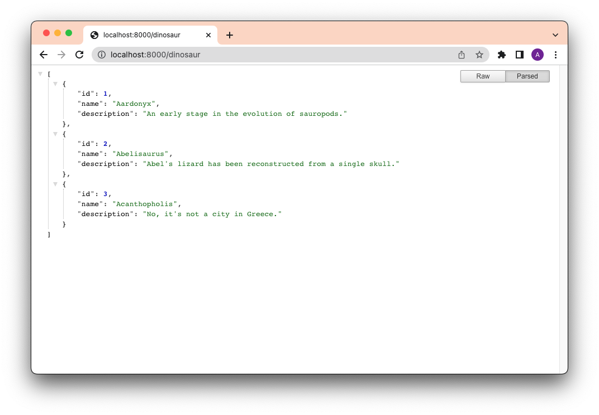

[Prisma](https://prisma.io) has been one of our top requested modules to work
with in Deno. The demand is understandable, given that Prisma's developer
experience is top notch and plays well with so many persistent data storage
technologies.

We're excited to show you how to use Prisma with Deno.

In this How To guide, we'll setup a simple RESTful API in Deno using Oak and
Prisma.

Let's get started.

[View source](https://github.com/denoland/examples/tree/main/with-prisma).

## Setup the application

Let's create the folder `rest-api-with-prisma-oak` and navigate there:

```shell
mkdir rest-api-with-prisma-oak
cd rest-api-with-prisma-oak
```

Prisma's CLI runs from `node_modules` and keeps its scripts and dependencies in
`package.json`, so let's create both files first. The `deno.json` tells Deno to
install npm packages into a local `node_modules` directory:

```shell
echo '{ "nodeModulesDir": "auto" }' > deno.json
echo '{ "name": "rest-api-with-prisma-oak", "private": true }' > package.json
```

Then, let's initialize Prisma ORM with Deno:

```shell
deno run -A --minimum-dependency-age=0 npm:prisma@latest orm init --yes --target postgres --authoring psl
```

Let's understand the key parameters:

- `--minimum-dependency-age=0`: Deno skips npm versions published in the last 24
  hours by default. Prisma ORM 8 ships release candidates often, so this lets
  Deno install the latest one.

- `--target postgres`: Sets up Prisma ORM for PostgreSQL.

- `--authoring psl`: Writes the data model in the Prisma Schema Language.

- `--yes`: Accepts the defaults for everything else.

The command detects Deno from `deno.json` and installs `@prisma/orm-postgres`
and the `prisma` CLI with `deno add`. It creates:

- `src/prisma/contract.prisma`: the data model, which Prisma ORM 8 calls a
  contract
- `src/prisma/db.ts`: the database client the rest of the app imports
- `prisma.config.ts`: tells the CLI where the contract is and reads the
  `DATABASE_URL` environment variable from `.env`

Let's update
[`src/prisma/contract.prisma`](https://www.prisma.io/docs/orm/contract-authoring/psl-syntax?utm_source=deno&utm_medium=docs&utm_campaign=deno_prisma_tutorial&utm_content=setup_schema)
with the following:

```ts
// use prisma-8

model Dinosaur {
  id          Int    @id @default(autoincrement())
  name        String @unique
  description String
}
```

:::tip

Keep the `// use prisma-8` line at the top of the file. It tells the Prisma CLI
which schema syntax the file uses.

:::

Next, we need a PostgreSQL database. If you don't have one, the following
command creates a free
[Prisma Postgres](https://www.prisma.io/postgres?utm_source=deno&utm_medium=docs&utm_campaign=deno_prisma_tutorial&utm_content=setup_database)
database and writes its connection string to `.env` as `DATABASE_URL`:

```shell
deno run -A npm:create-db@latest --env .env
```

The database is deleted after 24 hours unless you claim it with the link the
command prints. You can also set `DATABASE_URL` in `.env` to any other
PostgreSQL connection string.

Let's add two scripts to `package.json` next to the `contract:emit` script that
`orm init` created:

```json
"scripts": {
  "contract:emit": "prisma contract emit",
  "db:init": "prisma db init",
  "db:update": "prisma db update"
}
```

`deno task` runs these scripts with the project's `node_modules/.bin` on the
path, so they use the Prisma CLI version that `orm init` installed. Running
`npm:prisma` without a version would pick the Prisma ORM 7 CLI instead, which
doesn't understand the ORM 8 config file.

Now, let's generate the contract files that the client imports, and create the
`Dinosaur` table in the database:

```shell
deno task contract:emit
deno task db:init
```

`contract:emit` writes `src/prisma/contract.json` and `src/prisma/contract.d.ts`
next to the schema. Whenever you change the schema, run
`deno task contract:emit` again, followed by `deno task db:update` to apply the
change to the database.

Next, let's create a seed script to seed the database.

## Seed your Database

Create `./src/prisma/seed.ts`:

```shell
touch src/prisma/seed.ts
```

And in `./src/prisma/seed.ts`:

```ts
import { db } from "./db.ts";

const dinosaurData = [
  {
    name: "Aardonyx",
    description: "An early stage in the evolution of sauropods.",
  },
  {
    name: "Abelisaurus",
    description: "Abel's lizard has been reconstructed from a single skull.",
  },
  {
    name: "Acanthopholis",
    description: "No, it's not a city in Greece.",
  },
];

/**
 * Seed the database.
 */

for (const d of dinosaurData) {
  const dinosaur = await db.orm.public.Dinosaur.create(d);
  console.log(`Created dinosaur with id: ${dinosaur.id}`);
}
console.log(`Seeding finished.`);

await db.close();
```

On PostgreSQL, you reach a model through the schema it lives in, so the
`Dinosaur` model is at `db.orm.public.Dinosaur`. The `create` call is typed from
your contract and returns the inserted row.

We can now run `seed.ts` with:

```shell
deno run -A src/prisma/seed.ts
```

:::tip

`src/prisma/db.ts` loads `.env` through `dotenv`, so you don't need the `--env`
flag.

:::

You should see the following output:

```console
Created dinosaur with id: 1
Created dinosaur with id: 2
Created dinosaur with id: 3
Seeding finished.
```

## Create your API routes

We'll use [`oak`](https://jsr.io/@oak/oak) to create the API routes. Let's add
it to the project:

```shell
deno add jsr:@oak/oak
```

Then, let's create a `main.ts` file:

```shell
touch main.ts
```

And in your `main.ts` file:

```ts
import { Application, Router } from "@oak/oak";
import { db } from "./src/prisma/db.ts";

/**
 * Initialize.
 */

const app = new Application();
const router = new Router();

/**
 * Setup routes.
 */

router
  .get("/", (context) => {
    context.response.body = "Welcome to the Dinosaur API!";
  })
  .get("/dinosaur", async (context) => {
    // Get all dinosaurs.
    const dinosaurs = await db.orm.public.Dinosaur.all();
    context.response.body = dinosaurs;
  })
  .get("/dinosaur/:id", async (context) => {
    // Get one dinosaur by id.
    const { id } = context.params;
    const dinosaur = await db.orm.public.Dinosaur.where({ id: Number(id) })
      .first();
    context.response.body = dinosaur;
  })
  .post("/dinosaur", async (context) => {
    // Create a new dinosaur.
    const { name, description } = await context.request.body.json();
    const result = await db.orm.public.Dinosaur.create({ name, description });
    context.response.body = result;
  })
  .delete("/dinosaur/:id", async (context) => {
    // Delete a dinosaur by id.
    const { id } = context.params;
    const dinosaur = await db.orm.public.Dinosaur.where({ id: Number(id) })
      .delete();
    context.response.body = dinosaur;
  });

/**
 * Setup middleware.
 */

app.use(router.routes());
app.use(router.allowedMethods());

/**
 * Start server.
 */

await app.listen({ port: 8000 });
```

Now, let's run it:

```shell
deno run -A main.ts
```

Let's visit `localhost:8000/dinosaur`:



Next, let's `POST` a new user with this `curl` command:

```shell
curl -X POST http://localhost:8000/dinosaur -H "Content-Type: application/json" -d '{"name": "Deno", "description":"The fastest, most secure, easiest to use Dinosaur ever to walk the Earth."}'
```

The response is the new row, including the `id` the database assigned. Fetch it
back with its id:

```shell
curl http://localhost:8000/dinosaur/4
```

Nice!

## What's next?

Building your next app will be more productive and fun with Deno and Prisma,
since both technologies deliver an intuitive developer experience with data
modeling, type-safety, and robust IDE support.

To learn more about querying with Prisma ORM, see the
[Prisma ORM documentation](https://www.prisma.io/docs/orm/fundamentals/reading-data?utm_source=deno&utm_medium=docs&utm_campaign=deno_prisma_tutorial&utm_content=next_steps_reading_data).

If you're interested in connecting Prisma to Deno Deploy,
[check out this guide](https://www.prisma.io/docs/guides/integrations/deno?utm_source=deno&utm_medium=docs&utm_campaign=deno_prisma_tutorial&utm_content=next_steps_deno_deploy).
