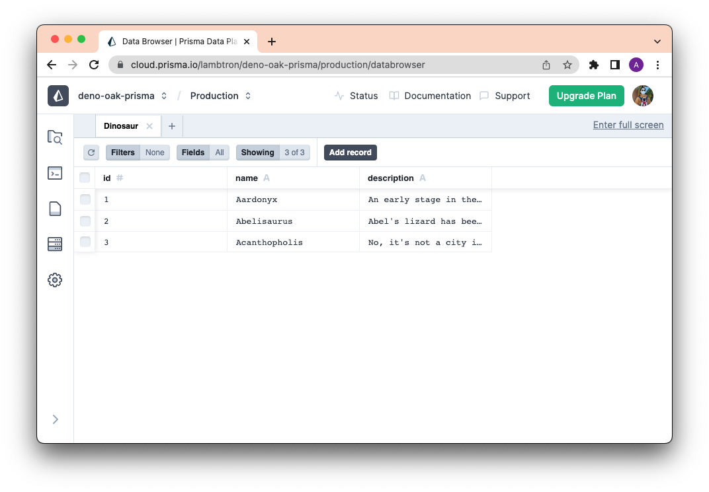
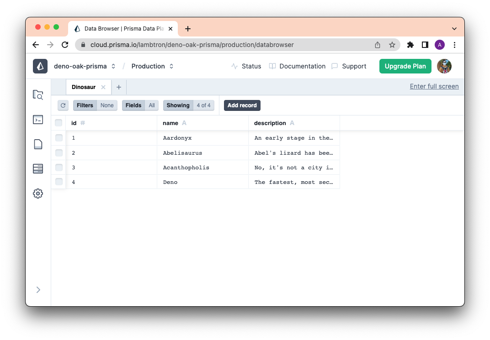

[Prisma](https://prisma.io) has been one of our top requested modules to work
with in Deno. The demand is understandable, given that Prisma's developer
experience is top notch and plays well with so many persistent data storage
technologies.

We're excited to show you how to use Prisma with Deno.

In this How To guide, we'll setup a simple RESTful API in Deno using Oak and
Prisma.

Let's get started.

[View source](https://github.com/denoland/examples/tree/main/with-prisma).

## Setup the application

Let's create the folder `rest-api-with-prisma-oak` and navigate there:

```shell
mkdir rest-api-with-prisma-oak
cd rest-api-with-prisma-oak
```

Then, let's run `prisma init` with Deno:

```shell
deno run -A npm:prisma@7 init --generator-provider prisma-client --output ./generated
```

Let's understand the key parameters:

- `npm:prisma@7`: This tutorial uses Prisma ORM 7. The `latest` tag of the
  `prisma` package points to a Prisma ORM 8 pre-release, which has a different
  CLI, so pin the major version.

- `--generator-provider prisma-client`: Use the `prisma-client` generator
  instead of the default `prisma-client-js`. The `prisma-client` generator
  outputs plain TypeScript and supports a Deno runtime target.

- `--output`: Defines the directory where Prisma will save the generated client
  files, including type definitions and database access utilities.

This will generate
[`prisma/schema.prisma`](https://www.prisma.io/docs/orm/v7/prisma-schema/overview?utm_source=deno&utm_medium=docs&utm_campaign=deno_prisma_tutorial&utm_content=setup_schema),
a `prisma7.config.ts` file that reads the database connection URL from the
`DATABASE_URL` environment variable, and a `.env` file. Let's update the schema
with the following:

:::tip

Don't forget to add `runtime = "deno"` to the generator block in your
schema.prisma file. This is required for Prisma to work correctly with Deno.

:::

```ts
generator client {
  provider = "prisma-client"
  output   = "./generated"
  runtime  = "deno"
}

datasource db {
  provider = "postgresql"
}

model Dinosaur {
  id          Int     @id @default(autoincrement())
  name        String  @unique
  description String
}
```

The `.env` file that `prisma init` created contains a placeholder `DATABASE_URL`
for a local database. Replace it with the connection string of a PostgreSQL
database. If you don't have one, the following command creates a free
[Prisma Postgres](https://www.prisma.io/postgres?utm_source=deno&utm_medium=docs&utm_campaign=deno_prisma_tutorial&utm_content=setup_database)
database and prints its connection string:

```shell
deno run -A npm:create-db@latest
```

The database is deleted after 24 hours unless you claim it with the link the
command prints. Copy the `postgres://` connection string into `.env`:

```text
DATABASE_URL="postgres://<username>:<password>@db.prisma.io:5432/postgres?sslmode=require"
```

Next, let's create the database schema:

```shell
deno run -A npm:prisma@7 db push
```

After that's complete, we'll need to generate a Prisma Client:

```shell
deno run -A npm:prisma@7 generate
```

Prisma Client connects to the database through a driver adapter. Let's add the
PostgreSQL adapter and the client package, along with Oak, which we'll use for
the API routes. Deno stores them in `node_modules` so the generated client can
resolve them:

```shell
echo '{ "nodeModulesDir": "auto" }' > deno.json
deno add npm:@prisma/client@7 npm:@prisma/adapter-pg@7 jsr:@oak/oak
```

Next, let's create a seed script to seed the database.

## Seed your Database

Create `./prisma/seed.ts`:

```shell
touch prisma/seed.ts
```

And in `./prisma/seed.ts`:

```ts
import { PrismaPg } from "@prisma/adapter-pg";
import { Prisma, PrismaClient } from "./generated/client.ts";

const adapter = new PrismaPg({ connectionString: process.env.DATABASE_URL });
const prisma = new PrismaClient({ adapter });

const dinosaurData: Prisma.DinosaurCreateInput[] = [
  {
    name: "Aardonyx",
    description: "An early stage in the evolution of sauropods.",
  },
  {
    name: "Abelisaurus",
    description: "Abel's lizard has been reconstructed from a single skull.",
  },
  {
    name: "Acanthopholis",
    description: "No, it's not a city in Greece.",
  },
];

/**
 * Seed the database.
 */

for (const u of dinosaurData) {
  const dinosaur = await prisma.dinosaur.create({
    data: u,
  });
  console.log(`Created dinosaur with id: ${dinosaur.id}`);
}
console.log(`Seeding finished.`);

await prisma.$disconnect();
```

We can now run `seed.ts` with:

```shell
deno run -A --env prisma/seed.ts
```

:::tip

The `--env` flag is used to tell Deno to load environment variables from the
`.env` file.

:::

After doing so, you should be able to see your data on Prisma Studio by running
the following command:

```bash
deno run -A npm:prisma@7 studio
```

You should see something similar to the following screenshot:



## Create your API routes

We'll use [`oak`](https://jsr.io/@oak/oak), which we added above, to create the
API routes. Let's keep them simple for now.

Let's create a `main.ts` file:

```shell
touch main.ts
```

Then, in your `main.ts` file:

```ts
import { PrismaPg } from "@prisma/adapter-pg";
import { PrismaClient } from "./prisma/generated/client.ts";
import { Application, Router } from "@oak/oak";

/**
 * Initialize.
 */

const adapter = new PrismaPg({ connectionString: process.env.DATABASE_URL });
const prisma = new PrismaClient({ adapter });
const app = new Application();
const router = new Router();

/**
 * Setup routes.
 */

router
  .get("/", (context) => {
    context.response.body = "Welcome to the Dinosaur API!";
  })
  .get("/dinosaur", async (context) => {
    // Get all dinosaurs.
    const dinosaurs = await prisma.dinosaur.findMany();
    context.response.body = dinosaurs;
  })
  .get("/dinosaur/:id", async (context) => {
    // Get one dinosaur by id.
    const { id } = context.params;
    const dinosaur = await prisma.dinosaur.findUnique({
      where: {
        id: Number(id),
      },
    });
    context.response.body = dinosaur;
  })
  .post("/dinosaur", async (context) => {
    // Create a new dinosaur.
    const { name, description } = await context.request.body.json();
    const result = await prisma.dinosaur.create({
      data: {
        name,
        description,
      },
    });
    context.response.body = result;
  })
  .delete("/dinosaur/:id", async (context) => {
    // Delete a dinosaur by id.
    const { id } = context.params;
    const dinosaur = await prisma.dinosaur.delete({
      where: {
        id: Number(id),
      },
    });
    context.response.body = dinosaur;
  });

/**
 * Setup middleware.
 */

app.use(router.routes());
app.use(router.allowedMethods());

/**
 * Start server.
 */

await app.listen({ port: 8000 });
```

Now, let's run it:

```shell
deno run -A --env main.ts
```

Let's visit `localhost:8000/dinosaur`:


Next, let's `POST` a new user with this `curl` command:

```shell
curl -X POST http://localhost:8000/dinosaur -H "Content-Type: application/json" -d '{"name": "Deno", "description":"The fastest, most secure, easiest to use Dinosaur ever to walk the Earth."}'
```

You should now see a new row on Prisma Studio:



Nice!

## What's next?

Building your next app will be more productive and fun with Deno and Prisma,
since both technologies deliver an intuitive developer experience with data
modeling, type-safety, and robust IDE support.

If you're interested in connecting Prisma to Deno Deploy,
[check out this guide](https://www.prisma.io/docs/guides/integrations/deno?utm_source=deno&utm_medium=docs&utm_campaign=deno_prisma_tutorial&utm_content=next_steps_deno_deploy).
